<h3><code>gabriel@github ~ $ whoami</code></h3>

  <a href="https://github.com/gabriel-albqr">github.com/gabriel-albqr</a>

  

  
  

 

<h3><code>gabriel@github ~ $ ./contributions.sh</code></h3>

  

<code>gabriel@github ~ $ cat stack.md</code>

 

| Categoria | Tecnologias |
| --- | --- |
| **Frontend** | React, TypeScript, JavaScript, PWA, responsividade web e mobile |
| **Mobile** | Flutter, Dart, arquitetura offline-first |
| **Backend** | Python, Django, Django REST Framework, APIs REST, testes unitários |
| **Dados** | PostgreSQL, MySQL, Oracle, SQLite, Redis |
| **Infraestrutura** | Docker, Docker Compose, Nginx |
| **Ferramentas** | Git, GitHub, VS Code, Android Studio, Postman, Figma |
| **Foco atual** | Flutter mobile offline-first · React + TypeScript com PWA · Django robusto e testável |

 

Desenvolvedor Full Stack · Usina Petribu S/A · Sistemas de Informação — Estácio, 6º período · Pernambuco, Brasil

